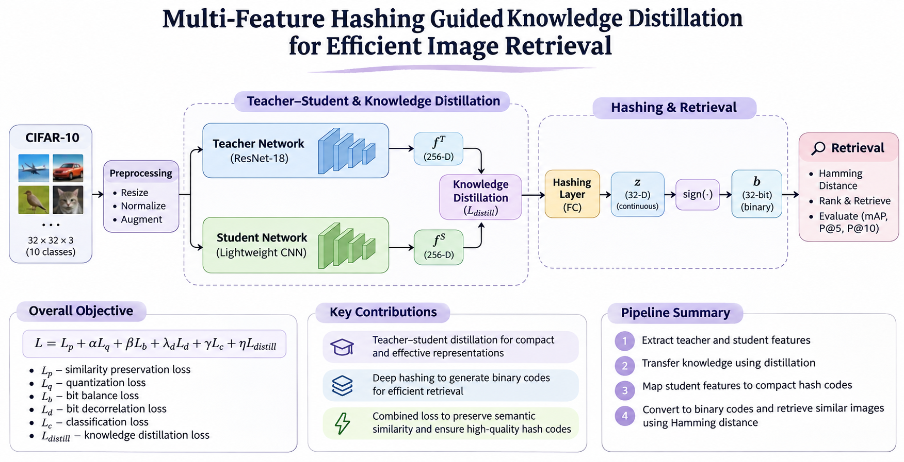
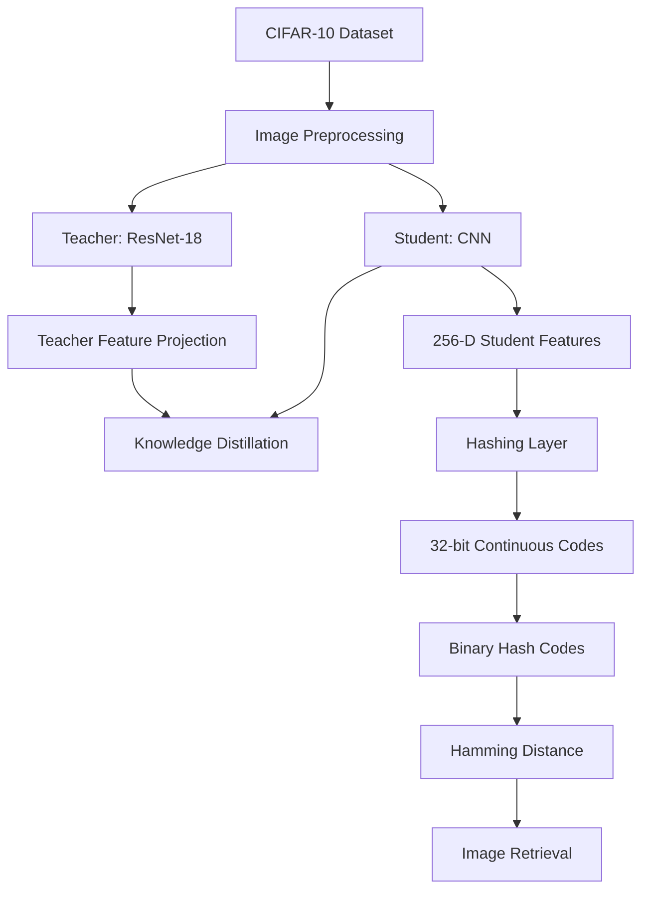

# Multi-Feature Hashing Guided Knowledge Distillation for Efficient Image Retrieval

An experimental deep learning project exploring knowledge distillation and deep hashing for efficient content-based image retrieval.

## Overview

Image retrieval systems aim to find visually similar images from a large database. Deep learning models can extract meaningful image representations, but storing and comparing high-dimensional feature vectors can be computationally expensive.

This project explores combining **Knowledge Distillation (KD)** with **Deep Hashing** to learn compact binary representations while retaining useful visual information.

A teacher–student learning setup is used to transfer feature knowledge from a larger network to a lightweight student network. The student representation is then mapped into compact binary hash codes for efficient similarity search.

## Objectives

- Learn compact image representations using a teacher–student framework.
- Transfer useful feature information through knowledge distillation.
- Generate binary hash codes for efficient image representation.
- Preserve semantic similarity between images.
- Evaluate retrieval performance using Hamming distance and retrieval metrics.

## Methodology

The current implementation explores the following pipeline:

1. **Dataset preparation:** CIFAR-10 images are loaded and preprocessed.
2. **Teacher network:** A ResNet-18-based teacher extracts feature representations.
3. **Knowledge distillation:** Teacher features are projected into the student feature space.
4. **Student network:** A lightweight CNN learns a 256-dimensional feature representation.
5. **Hashing:** A hashing layer maps student features into compact 32-bit continuous codes.
6. **Binary conversion:** Continuous codes are converted into binary values using thresholding.
7. **Retrieval:** Images are ranked using Hamming distance between binary codes.

## Architecture




## Hashing Objective

The hashing model uses a combined objective consisting of six loss components:

- Similarity preservation loss
- Quantization loss
- Bit balance loss
- Bit decorrelation loss
- Classification loss
- Knowledge distillation loss

The overall objective is:

\[
L = L_p + \alpha L_q + \beta L_b
+ \lambda_d L_d + \gamma L_c + \eta L_{distill}
\]

These objectives encourage the model to preserve semantic relationships, produce balanced and less-correlated hash bits, and retain useful student features.

## Dataset

**CIFAR-10**

- 10 image classes
- 32 × 32 RGB images
- 50,000 training images
- 10,000 test images

The current experimental training scripts use a subset of 1,000 training images. The retrieval evaluation script uses 1,000 database images and 100 query images.

The dataset is downloaded automatically through `torchvision` when required.

## Technology Stack

| Component | Technology |
|---|---|
| Programming language | Python |
| Deep learning | PyTorch |
| Computer vision | Torchvision |
| Numerical computing | NumPy |
| Visualization | Matplotlib |
| Evaluation | Scikit-learn |
| Image processing | Pillow |

## Repository Structure

```text
multifeature_hashing_kd/
│
├── checkpoints/
│   └── Training checkpoints
│
├── models/
│   ├── distillation.py
│   ├── hashing.py
│   ├── hashing_losses.py
│   ├── student.py
│   ├── teacher.py
│   └── test_hashing_losses.py
│
├── retrieval/
│   ├── baseline.py
│   ├── check_student_feature.py
│   ├── compare_features.py
│   ├── compare_models.py
│   ├── evaluate.py
│   ├── evaluate_hashing.py
│   ├── evaluate_student.py
│   └── evaluate_student_v2.py
│
├── train_distillation.py
├── train_distillation_v2.py
├── train_distillation_v3.py
├── train_hashing.py
│
├── distilled_student.pth
├── distilled_student_v2.pth
├── hashing_model_32bit.pth
├── hashing_model_32bit_kdv2.pth
│
├── requirements.txt
└── .gitignore
```

## Installation

Clone the repository:

```bash
git clone https://github.com/Mankiratbedi/multifeature_hashing_kd.git

cd multifeature_hashing_kd
```

Create a virtual environment:

```bash
python -m venv .venv
```

Activate it on Windows:

```powershell
.venv\Scripts\activate
```

Install dependencies:

```bash
pip install -r requirements.txt
```

## Running the Project

### 1. Train the student using knowledge distillation

```bash
python train_distillation_v2.py
```

This trains the student network using teacher feature representations and saves the resulting checkpoint.

### 2. Train the hashing model

```bash
python train_hashing.py
```

Note: The hashing training script expects the KD-v2 checkpoint and a precomputed teacher-feature cache at `data/teacher_features_1000.pt`.

### 3. Evaluate image retrieval

```bash
python retrieval/evaluate_hashing.py
```

The evaluation script extracts binary codes, calculates Hamming distances and evaluates retrieval performance.

Run the relevant training stages and prepare their required checkpoints and feature cache before evaluation.

## Evaluation Metrics

The retrieval implementation includes:

- Mean Average Precision (mAP)
- Precision@5
- Precision@10
- Hamming distance
- Binary code diversity diagnostics
- Feature similarity diagnostics

Quantitative results will be added after completing and validating the experiments.

## Current Progress

- [x] CIFAR-10 data loading and preprocessing
- [x] Teacher–student knowledge distillation experiments
- [x] Student feature extraction
- [x] Binary hashing layer implementation
- [x] Multi-component hashing loss implementation
- [x] Model checkpoint generation
- [x] Hamming distance-based retrieval implementation
- [ ] Comprehensive baseline comparisons
- [ ] Further multi-scale feature fusion experiments
- [ ] Complete ablation studies and final evaluation

## Future Work

- Explore multi-scale feature extraction and fusion.
- Improve student representation learning.
- Experiment with different hash code lengths.
- Compare knowledge-distilled and non-distilled hashing models.
- Perform ablation studies on individual loss components.
- Evaluate retrieval performance on larger datasets.

---

**Project:** Multi-Feature Hashing Guided Knowledge Distillation for Efficient Image Retrieval

**Repository:** https://github.com/Mankiratbedi/multifeature_hashing_kd
